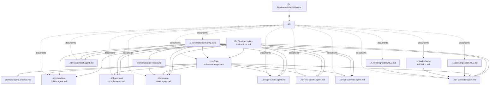

# DRL Pipeline Workflow Documentation

This file explains the DRL Pipeline agent workflow, file dependencies, and execution flow.

## Flow Diagram

## Why Each Markdown File Exists

| File | Why it exists | Needs config.json |
|---|---|---|
| `copilot-instructions.md` | DRL Pipeline-specific operating rules and workflow constraints. | No |
| `WORKFLOW.md` | This file - human-readable map of the DRL Pipeline file graph. | No |
| `../drl-flow-orchestrator.agent.md` | Defines the stage order and decides which stage should run next. | Yes |
| `prompts/agent_protocol.md` | Shared contract for how agents read state, write artifacts, and respect guardrails. | Indirectly |
| `../drl-source-intake.agent.md` | Canonical context-efficient source stage: ticket intake, PR/CQL resolution, CQL fetch, extraction, plan, and approval placeholder. | Yes |
| `prompts/source-intake.md` | Minimal prompt content referenced by the manifest for the source-intake stage. | Yes |
| `../drl-baseline-builder.agent.md` | Defines how prior-year DRL baseline templates are fetched and rolled to current year before conversion. | Yes |
| `../drl-approval-recorder.agent.md` | Defines how explicit human approval details are recorded before PR submission. | Yes |
| `../drl-ticket-reset.agent.md` | Defines the explicit, user-requested reset path for a clean rerun. It is not part of normal orchestration. | Yes |
| `../drl-converter.agent.md` | Defines how extraction output becomes DRL and mapping output. | Yes |
| `../drl-api-builder.agent.md` | Defines how local-python MCP retrieves authenticated API payloads and converts them into PR-ready measure JSON. | Yes |
| `../drl-test-builder.agent.md` | Defines how the PR-ready Java test run file is cloned from prior-year source and rolled forward by year only. | Yes |
| `../drl-pr-submitter.agent.md` | Defines how converted output becomes a PR draft and GitHub update. | Yes |
| `../../skills/mips-drl/SKILL.md` | Dynamic MIPS conversion skill used by the conversion stage and mapping output. | No |
| `../../skills/hedis-drl/SKILL.md` | Dynamic HEDIS conversion skill, including CE and max coverage patterns. | No |
| `../../skills/cqm-drl/SKILL.md` | Dynamic CQM/CMS/eCQM conversion skill. | No |
| `../../skills/drl-review-rules/SKILL.md` | Pointer to the rules-engine PR-review rules, loaded for every program. | No |

## What config.json Is For

`../../orchestration/config.json` is the runtime manifest.

It exists because the workflow needs one place to define:

- stage order
- which agent file belongs to each stage
- optional prompt modules for stages that use them
- which files each stage writes
- global guardrails
- GitHub repository settings used by PR submission

Without `config.json`, the orchestrator and the stage agents would not have a shared source of truth for sequencing and guardrails.

## Files That Directly Need config.json

These files read or depend on `../../orchestration/config.json` at runtime:

- `../drl-flow-orchestrator.agent.md`
- `../drl-source-intake.agent.md`
- `../drl-baseline-builder.agent.md`
- `../drl-approval-recorder.agent.md`
- `../drl-ticket-reset.agent.md`
- `../drl-converter.agent.md`
- `../drl-api-builder.agent.md`
- `../drl-test-builder.agent.md`
- `../drl-pr-submitter.agent.md`
- prompt modules referenced inside `config.json`

## Config References That Matter

`config.json` currently points to this canonical prompt module:

- `prompts/source-intake.md`

Additional shared protocol file:

- `prompts/agent_protocol.md`

## Minimal Dependency Rules

- All stage agents depend on `copilot-instructions.md` for DRL Pipeline-specific rules.
- All runtime stages depend on `../../orchestration/config.json` for sequencing and guardrails.
- The orchestrator depends on `prompts/agent_protocol.md` for shared behavior.
- Reset is not a normal orchestrator handoff; it is available only through `/drlTicketReset` after an explicit user reset or clean-rerun request.
- The conversion stage uses dynamic skill candidates (`hedis-drl`, `mips-drl`, `cqm-drl`, `drl-review-rules` under `../../skills/`); it should load only the files relevant to the detected program and change.
- Source intake is the only canonical stage using a prompt module from config.

## Runtime Guide

Detailed run flow, exact commands, MCP startup location, and stage-by-stage verification are in:

- `docs/runtime-flow.md`

## DRL Pipeline Bundle Structure

The DRL Pipeline agents are organized as a bundle under `.github/agents/Drl Pipeline/`:

- **Agent definitions**: Individual `drl-*.agent.md` files in `.github/agents/`
- **Runtime scripts**: `scripts/`
- **Documentation**: `docs/`
- **Configuration**: `config/`
- **Templates**: `templates/`
- **State files**: `state/`
- **Prompts**: `prompts/`
- **Artifacts**: `artifacts/`

This structure allows the DRL pipeline to be portable and self-contained while keeping agent definitions at the standard `.github/agents/` level for VS Code agent discovery.
