# Architecture: Local Multi-Agent CQL to DRL Pipeline

## Overview

The workflow is intentionally split into specialist agents with strict stage boundaries.

1. Intake Agent: ticket and metadata retrieval
2. Extractor Agent: CQL parse and semantic extraction
3. Baseline Template Agent: prior-year DRL retrieval and year roll-forward
4. Conversion Agent: baseline delta application from CQL changes
5. Approval Agent: explicit human approval checkpoint after conversion
6. API Artifact Agent: authenticated measure JSON generation
7. Test Artifact Agent: canonical Java test file generation
8. PR Agent: PR creation and final submission state

## Why This Split

- Better auditability and easier troubleshooting
- Reduced context pressure per agent
- Clear ownership of intermediate artifacts

## Data Flow

- Input: ADO ticket id
- Intermediate: JSON/Markdown artifacts per stage
- Output: DRL files (one per changed CQL), mapping notes, PR draft text

## DRL Modeling Standard

- Conversion output fact modeling must mirror reference DRLs in `examples/drl-reference/year2026/`.
- Prefer platform domain facts (`Program`, `Patient`, `ClinicalActivity`, `EncounterDenominator`, etc.) over synthetic wrapper records.
- Restrict `declare` usage to marker/helper state facts needed for dedup or source splitting.

## Approval Gate

No PR submission may start until `.github/agents/Drl Pipeline/artifacts/<ticket-id>/state/approval-status.json` is set to:

{
  "ticketId": "<ticket-id>",
  "approved": true,
  "approvedBy": "<name>",
  "approvedAt": "<iso-8601>"
}

## Local and Cloud Execution

The workflow supports two equivalent execution paths:

1. **Local VS Code** – developers run `python .github/agents/Drl Pipeline/scripts/local_mcp_server.py`, load `.vscode/mcp.json` in VS Code, and invoke slash commands in Copilot Chat.
2. **GitHub Actions / Copilot cloud agent** – the `copilot-setup-steps.yml` workflow installs dependencies and starts the local Python MCP server before the Copilot cloud agent begins. MCP server configuration is discovered from `.github/copilot/mcp.json`. Ticket initialization can also be triggered from the `orchestrator-run.yml` workflow via the Actions tab.

Both paths share the same agent files, the same state structure, and the same approval gate.

---

## Agent Execution Flow

```mermaid
flowchart TD
    START(["User: populate .github/agents/Drl Pipeline/state/run-input.json\nwith ticketUrl"])
    START --> O

    O["fa:fa-sitemap /drlFlowOrchestrator\nReads pipeline-status.json\nAuto-runs valid stages through conversion"]
    O --> A

    subgraph STAGE1["Stage 1 - Source Intake + Plan Draft"]
        A["/drlSourceIntake\nFetches ADO ticket via MCP\nResolves PR links and CQL paths\nFetches CQL and extracts definitions"]
        A --> A_OUT[".github/agents/Drl Pipeline/artifacts/<ticket-id>/intake.json\n.github/agents/Drl Pipeline/artifacts/<ticket-id>/extraction.json\n.github/agents/Drl Pipeline/artifacts/<ticket-id>/plan.md\napproval-status.json approved=false\npipeline: extraction-complete"]
    end

    A_OUT --> C

    subgraph STAGE3["Stage 3 – Baseline Template"]
        C["/drlBaselineBuilder\nFetches prior-year DRL from rules-engine\nRolls year values forward\nWrites baseline and required prior-year CQL diff"]
        C --> C_OUT[".github/agents/Drl Pipeline/artifacts/<ticket-id>/drls/baseline/<measure-slug>.drl\n.github/agents/Drl Pipeline/artifacts/<ticket-id>/baseline/<measure-slug>-baseline.json\npipeline: baseline-template-ready"]
    end

    C_OUT --> D

    subgraph STAGE4["Stage 4 - Conversion"]
        D["/drlConverter\nApplies CQL deltas on baseline DRL\nRuns validate_conversion_artifacts.py"]
        D --> D_OUT[".github/agents/Drl Pipeline/artifacts/<ticket-id>/drls/generated/<measure-slug>.drl\n.github/agents/Drl Pipeline/artifacts/<ticket-id>/mapping.md\npipeline: conversion-complete"]
    end

    D_OUT --> G

    subgraph STAGE5["Stage 5 - Record Approval"]
        G["/drlApprovalRecorder\nUser provides approver name + note\nSets approved: true with timestamp"]
        G --> G_OUT["approval-status.json approved=true\npipeline: pr-ready"]
    end

    G_OUT --> E

    subgraph STAGE6["Stage 6 - API Artifact"]
        E["/drlApiBuilder\nGets auth token from auth API\nCalls measure payload API\nWrites canonical JSON artifact"]
        E --> E_OUT[".github/agents/Drl Pipeline/artifacts/&lt;id&gt;/pr-assets/&lt;measure-slug&gt;.json\npipeline: api-artifact-ready"]
    end

    E_OUT --> F

    subgraph STAGE7["Stage 7 - Test Artifact"]
        F["/drlTestBuilder\nClones previous-year Java test source\nApplies year-only roll-forward to YearYYYY&lt;MeasureFamilyPascal&gt;NNNTest.java"]
        F --> F_OUT[".github/agents/Drl Pipeline/artifacts/&lt;id&gt;/pr-assets/YearYYYY&lt;MeasureFamilyPascal&gt;NNNTest.java\npipeline: test-artifact-ready"]
    end

    F_OUT --> H

    subgraph STAGE8["Stage 8 - PR Submission"]
        H["/drlPrSubmitter\nPublishes approved DRL + JSON + test files\nvia local-python MCP tools in one commit\nOpens GitHub PR"]
        H --> H_OUT["artifacts/pr/&lt;id&gt;-pr.md\nGitHub PR created\npipeline: pr-submitted"]
    end

    H_OUT --> DONE(["Done"])

    style HUMAN fill:#ffe599,stroke:#f0b429,color:#333
    style O fill:#d9ead3,stroke:#6aa84f
    style START fill:#cfe2f3,stroke:#3d85c8
    style DONE fill:#cfe2f3,stroke:#3d85c8
```

### Orchestrator and Human Intervention

The `/drlFlowOrchestrator` is the **primary execution entrypoint**. It resolves `ticketId` from `.github/agents/Drl Pipeline/state/run-input.json`, reads `.github/agents/Drl Pipeline/artifacts/<ticket-id>/state/pipeline-status.json`, and resumes from the current pipeline stage to run the remaining valid stages automatically through conversion/DRL generation before stopping at the approval gate. For new tickets with missing/empty pipeline state, it starts at intake.

**Mandatory human touch-points (by design):**

| Touch-point | Why it cannot be automated |
|---|---|
| Populate `run-input.json` | User must supply the ADO ticket URL (or ticket ID) to start the run |
| Approval review (Stage 5 hard stop) | Core Rule 1: PR submission is blocked until a named human explicitly approves |
| Provide approver name to `/drlApprovalRecorder` | Ensures a traceable, non-automated approval identity |

**Net result:** Pre-approval stages run in a single orchestrator execution. If any pre-approval stage fails, orchestration halts at that stage and resume/recovery proceeds from the recorded pipeline status on the next orchestrator run. The single required human decision point is `/drlApprovalRecorder` after conversion artifacts are generated.
